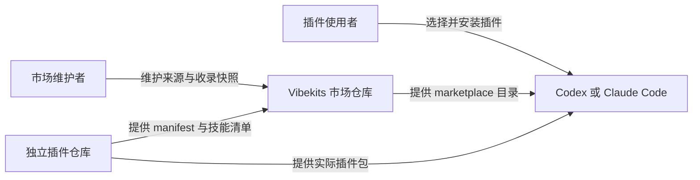
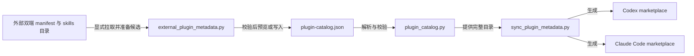

# 市场架构与数据契约

核对基线：2026-10-12 独立插件仓库迁移后的当前实现。后续工作见[路线图](../roadmap.md)，具体操作见[维护指南](../maintenance.md)。

## 系统上下文

Vibekits 是 Codex、Claude Code 与 DSH 的插件市场。它保存外部来源和展示快照，插件客户端从对应独立仓库取得实际安装包。

本市场负责来源与收录快照更新、三端目录生成、包内技能入口核对和安装更新说明。客户端负责执行刷新、安装、更新及已安装插件管理；客户端的启停、本地版本恢复、安装隔离和失败恢复不作为市场交付门槛。核对市场声明的来源、版本与技能清单仍属于本仓库的维护责任。

[README](../../README.md)维护插件选择与首次使用。技能正文、模板、例库、插件专属设计和审查由对应独立仓库维护，入口见[文档索引](../index.md#独立插件资料)。本市场不保留这些内容的第二份副本，也不生成外部插件的 manifest。

## 数据来源与生成过程

独立仓库决定插件身份、版本和内容；[`plugin-catalog.json`](../../plugin-catalog.json)保存本市场核对后的收录快照及平台策略。两份 marketplace 和 DSH 索引都是生成物，不直接编辑。

图中的拉取与生成是维护者按需运行的 Python 命令，不是持续运行的服务。生成目标为 [Codex marketplace](../../.agents/plugins/marketplace.json) 和 [Claude Code marketplace](../../.claude-plugin/marketplace.json)。

### Catalog 契约

当前 `schemaVersion` 为 `1`，主要数据按以下职责组织：

| 字段 | 含义与约束 |
| --- | --- |
| `marketplace`、`publisher` | 聚合市场身份、所有者与仓库地址；市场 ID 用于客户端安装命名空间。 |
| `plugins[].id`、`version`、`description`、`category`、`keywords` | 稳定插件 ID、SemVer 版本和收录介绍；ID 使用小写 kebab-case，插件 ID 不重复。 |
| `plugins[].source` | `{"type": "github", "repo": "owner/repo", "ref": "main"}`；`ref` 可省略以跟随默认分支，当前收录显式使用 `main`。不接受旧 `directory` 本地包字段。 |
| `plugins[].skills` | 完整技能收录清单；每项包含 `id` 与 `path`，路径必须为 `skills/<skill-id>`，Skill ID 在整个市场中唯一。 |
| `plugins[].manifestMetadata` | 从外部 Codex manifest 回填的 `author`、`homepage`、`repository`、`license` 快照。 |
| `plugins[].platforms.codex` | 安装与认证策略、展示开关及允许携带的 `interface` 展示字段。 |
| `plugins[].platforms.claude` | Claude Code 的分类、标签及发布者快照。 |

`repo` 不含 `.git` 后缀；`ref` 不得以短横线开头或包含空白、控制字符。技能路径拒绝绝对路径、越界路径和反斜杠。详细校验以 [`parse_catalog`](../../scripts/plugin_catalog.py) 为准；离线解析不会访问外部包。

### 平台适配与安装前展示

同一个 GitHub 来源在 Codex 中生成 `source: "url"`、仓库 URL 和可选 `ref`，在 Claude Code 中生成 `source: "github"`、`repo` 和可选 `ref`。两端都从独立仓库根目录获取插件。

Codex 的 `platforms.codex.marketplaceMetadata: true` 让市场条目附带安装前展示快照。当前四个插件均已开启；名称、简介、详细介绍、推荐提示词、发布者和分类以独立仓库实际 manifest 为准。`homepage`、`repository` 与 `interface.websiteURL` 应指向插件自己的仓库。

市场展示不携带 `skills` 等包内路径，不复制包内图标或截图文件。安装前技能列表与包内资源是否显示取决于客户端实际加载，不能借用旧本地插件补齐。新增展示字段时先核对 [`CODEX_INTERFACE_METADATA_FIELDS`](../../scripts/plugin_catalog.py)，平台专属配置只进入对应适配层。

### 快照回填与失败处理

1. 按 catalog 的 `repo/ref` 克隆选中的独立仓库到临时目录，在同一 checkout 中读取双端 manifest 和 `skills/*/SKILL.md`，不执行插件脚本。
2. 核对双端名称、版本、描述和仓库地址；回填还要求 Codex 的 `skills` 为 `"./skills/"`，Claude Code 的 `skills` 为 `["./skills/"]`。
3. 更新版本、描述、关键词、完整技能清单、发布者和展示字段。已有技能保留顺序，新技能按名称追加；本市场的来源、安装与认证策略、展示开关、Claude 分类和标签保持原值。
4. 对已登记 `platforms.dsh` 的插件，读取同一 checkout 根目录的 `package.json` 和 `HEAD` 完整 SHA，核对包名、双端版本、非空兼容声明与 bundle patch。包的 `description`、`author`、`homepage`、`repository` 进入 DSH 独立展示快照；版本、commit 与兼容范围形成同一条发布候选，不读取本地未推送源码。
5. 新版本只有获得与插件／版本／commit 精确绑定的发布时间及证据后才追加到 `versions`；已有版本不改来源、范围或时间。同版本换来源、时间冲突或新版本缺少时间列为待补，禁止整次写入。同步还逐条读取已登记固定 commit 的包声明，核对历史身份、版本和兼容范围，不用分支最新内容替代历史。
6. 校验完整候选 catalog，包含未选中的兄弟插件。默认输出摘要及 catalog、两份 marketplace 和 DSH 索引的差异；只有无待补项且传入 `--write` 才准备并替换文件。

远端拉取失败或候选校验失败时不写文件。外部回填的写入会先准备同目录临时文件，替换过程中发生 `OSError` 时尝试恢复已替换文件，并清理临时文件；这不是跨文件的原子事务。

不传 `--fetch-external` 时只离线检查或生成两份 marketplace 和 DSH 索引，不拉取上游兼容声明；即使选择单个插件，生成结果仍包含完整市场。所有同步命令都不修改独立仓库、不安装插件、不提交或推送。

## 检查能够证明什么

| 检查 | 能够证明 | 不覆盖 |
| --- | --- | --- |
| 元数据生成一致性 | catalog 可解析，两端 marketplace 与当前生成规则一致。 | 外部仓库当前内容、客户端展示。 |
| 本地安装契约 | Codex 市场身份与完整条目集合、来源、策略、分类，以及双语 README 的安装入口正确。 | 实际包内文件、真实安装。 |
| `--check-external` | 临时读取外部双端 manifest 的身份、版本、描述、仓库地址，核对 Codex `skills` 路径和 catalog 承诺的全部技能入口；逐条 checkout DSH 发布 SHA，核对包身份、版本、兼容范围和 patch，以及该提交的双端版本。 | 发布时间证据真实性、额外技能是否未收录、完整 manifest schema、技能行为、客户端生命周期；使用本地覆盖的插件不检查历史 SHA。 |
| `--remote` | 从聚合市场远端 checkout 执行同一安装契约检查；是否读取外部包仍由 `--check-external` 决定。 | 尚未推送的本地文档、客户端安装。 |
| 真实客户端验证 | 在指定客户端、版本与配置中观察到的展示、安装、加载或生命周期结果。 | 其他客户端或未经操作的生命周期环节。 |

安装检查会逐插件报告问题，并核对两份 README 已有的聚合市场添加命令与独立一行的 `/plugins`；插件 ID 集合由 catalog 与生成目录核对，不要求向 README 新增条目。完整技能集合由回填时枚举；外部安装检查只核对 catalog 中声明的入口，不把它描述成完整目录差异检查。

本地 Markdown 链接脚本只检查行内 Markdown 文件链接的目标存在性，跳过外部 URL 和页内锚点；HTML 链接、引用式链接及锚点需要另外核对。

## 源码与依赖

| 文件或分组 | 职责 |
| --- | --- |
| [plugin_catalog.py](../../scripts/plugin_catalog.py) | 解析 catalog，统一插件选择、跨插件冲突、路径和平台字段校验。 |
| [external_plugin_metadata.py](../../scripts/external_plugin_metadata.py) | 读取临时外部 checkout，准备收录候选；复用安装检查中的克隆与仓库地址解析。 |
| [sync_plugin_metadata.py](../../scripts/sync_plugin_metadata.py) | 生成两端市场、检测漂移，并组织外部预览和写入。 |
| [check_codex_install.py](../../scripts/check_codex_install.py) | 核对本地或远端市场及 README 安装契约，按需读取外部包。 |
| [check_markdown_links.py](../../scripts/check_markdown_links.py) | 检查仓库 Markdown 中的本地文件链接。 |
| [test_plugin_catalog.py](../../tests/test_plugin_catalog.py)、[fixtures](../../tests/fixtures) | 既有 catalog 测试与冲突、越界路径样本，覆盖外部条目、生成幂等和手动漂移。 |
| [plugin-validation.yml](../../.github/workflows/plugin-validation.yml) | 在 Windows、Python 3.13 下运行离线元数据、安装契约、链接、diff 与 catalog 测试。 |

维护脚本使用 Python 标准库，没有第三方 Python 依赖；Git 用于查找仓库文件和克隆远端，外部检查另需网络。CI 的运行版本不等于已声明的最低环境要求。执行这些检查不需要调用模型或复制凭据；真实客户端操作另需对应客户端及其可用账户。

[返回文档索引](../index.md) · [维护指南](../maintenance.md)

## DSH 索引与未发布版本

`platforms.dsh` 可选，包含 npm 包身份 `name`、可选展示快照 `metadata` 及 `versions` 数组。未提供该字段的插件不进入 DSH 市场。`versions: []` 表示尚无可分发记录；缺少发布时间的新候选只出现在预览提示中，不生成虚假的可安装版本。

每个发布版本分别记录：

- `version`：与该提交的 DSH 包和双端 manifest 一致的版本，数组内不得重复。
- `engines`：该提交包内的 `engines.dsh` 字符串，生成索引时转换成 `engines: {"dsh": ...}`，不验证实际运行兼容性或完整 SemVer 范围语法。
- `source`：`type: git`、同独立仓库 HTTPS `url`、完整 40 位 `commit`，可选仓库内 `path`。现有子目录记录可被固定提交检查读取；自动生成的新候选使用根包，不推测新的子目录来源。
- `publishTimestamp`：真实发布时间，Unix 秒正整数；不从 commit 时间或当前时间推算。
- `publishEvidence`：新记录通过 `--release-info` 提供的发布证据引用，只保存在 catalog。既有记录可缺省，不伪造历史证据；脚本核对输入绑定及格式，证据真实性由维护者确认。

为读取旧快照，parser 仍接受旧插件级 `engines`，仅在历史记录缺少该字段时将旧值复制到记录副本；单条记录已有值时优先保留。外部回填选中插件时输出逐版本结构，并核对其固定提交，不用最新包范围批量覆盖历史。本仓库现有记录已按原值迁移；版本、commit 与原时间未改变，生成索引仍使用原来的 DSH 格式。

`metadata` 只保存包声明中实际存在的 `description`、`author`、`homepage`、`repository`。作者对象取 `name`；仓库 URL 归一化并核对仍为登记仓库。同步后缺失字段不会再由市场发布者或 Codex 文案补齐；未回填过 `metadata` 的旧快照暂时沿用原展示值。标题仍取 Codex 的显示名称，不新增包内图标、截图或依赖清单。

生成器输出 [dsh/index.json](../../dsh/index.json)；DSH 原生支持其他来源，但本 catalog 当前只实现同仓库 Git 来源。默认预览不写文件；待补预览返回 `2`，写入时发现待补返回 `1` 并拒绝所有文件变更，具体补充时间的格式见[维护指南](../maintenance.md#为新版本补充发布时间)。

本地修改通过安装检查的 `--local-plugin ID=/absolute/path` 显式选取；该参数须配合 `--check-external`，不能与 `--remote` 同用，输出标注 LOCAL。检查核对双端 manifest、Skill 和当前 DSH bundle 身份／版本／范围声明／patch，不 checkout 本地目录或验证该插件的历史记录，也不把本地检查描述成远端安装成功。
