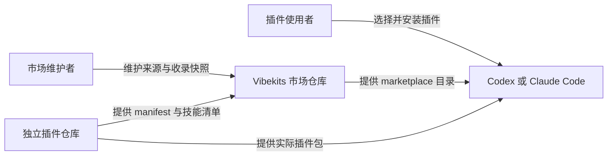
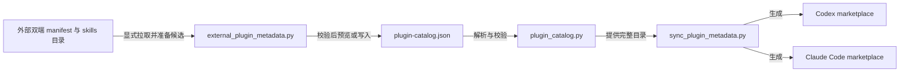

# 市场架构与数据契约

核对基线：2026-10-12 独立插件仓库迁移后的当前实现。后续工作见[路线图](../roadmap.md)，具体操作见[维护指南](../maintenance.md)。

## 系统上下文

Vibekits 是 Codex 与 Claude Code 的插件市场。它保存外部来源和展示快照，插件客户端从对应独立仓库取得实际安装包。

本市场负责来源与收录快照更新、两端 marketplace 生成、包内技能入口核对和安装更新说明。客户端负责执行刷新、安装、更新及已安装插件管理；客户端的启停、本地版本恢复、安装隔离和失败恢复不作为市场交付门槛。核对市场声明的来源、版本与技能清单仍属于本仓库的维护责任。

[README](../../README.md)维护插件选择与首次使用。技能正文、模板、例库、插件专属设计和审查由对应独立仓库维护，入口见[文档索引](../index.md#独立插件资料)。本市场不保留这些内容的第二份副本，也不生成外部插件的 manifest。

## 数据来源与生成过程

独立仓库决定插件身份、版本和内容；[`plugin-catalog.json`](../../plugin-catalog.json)保存本市场核对后的收录快照及平台策略。两份 marketplace 都是生成物，不直接编辑。

图中的拉取与生成是维护者按需运行的 Python 命令，不是持续运行的服务。生成目标为 [Codex marketplace](../../.agents/plugins/marketplace.json) 和 [Claude Code marketplace](../../.claude-plugin/marketplace.json)。

### Catalog 契约

当前 `schemaVersion` 为 `1`，主要数据按以下职责组织：

| 字段 | 含义与约束 |
| --- | --- |
| `marketplace`、`publisher` | 聚合市场身份、所有者与仓库地址；市场 ID 用于客户端安装命名空间。 |
| `plugins[].id`、`version`、`description`、`category`、`keywords` | 稳定插件 ID、SemVer 版本和收录介绍；ID 使用小写 kebab-case，插件 ID 不重复。 |
| `plugins[].source` | `{"type": "github", "repo": "owner/repo", "ref": "main"}`；`ref` 可省略以跟随默认分支，当前收录显式使用 `main`。不接受旧 `directory` 本地包字段。 |
| `plugins[].skills` | 完整技能收录清单；每项包含 `id` 与 `path`，路径必须为 `skills/<skill-id>`，Skill ID 在整个市场中唯一。 |
| `plugins[].manifestMetadata` | 从外部 Codex manifest 回填的 `author`、`homepage`、`repository`、`license` 快照。 |
| `plugins[].platforms.codex` | 安装与认证策略、展示开关及允许携带的 `interface` 展示字段。 |
| `plugins[].platforms.claude` | Claude Code 的分类、标签及发布者快照。 |

`repo` 不含 `.git` 后缀；`ref` 不得以短横线开头或包含空白、控制字符。技能路径拒绝绝对路径、越界路径和反斜杠。详细校验以 [`parse_catalog`](../../scripts/plugin_catalog.py) 为准；离线解析不会访问外部包。

### 平台适配与安装前展示

同一个 GitHub 来源在 Codex 中生成 `source: "url"`、仓库 URL 和可选 `ref`，在 Claude Code 中生成 `source: "github"`、`repo` 和可选 `ref`。两端都从独立仓库根目录获取插件。

Codex 的 `platforms.codex.marketplaceMetadata: true` 让市场条目附带安装前展示快照。当前三个插件均已开启；名称、简介、详细介绍、推荐提示词、发布者和分类以独立仓库实际 manifest 为准。`homepage`、`repository` 与 `interface.websiteURL` 应指向插件自己的仓库。

市场展示不携带 `skills` 等包内路径，不复制包内图标或截图文件。安装前技能列表与包内资源是否显示取决于客户端实际加载，不能借用旧本地插件补齐。新增展示字段时先核对 [`CODEX_INTERFACE_METADATA_FIELDS`](../../scripts/plugin_catalog.py)，平台专属配置只进入对应适配层。

### 快照回填与失败处理

1. 按 catalog 的 `repo/ref` 克隆选中的独立仓库到临时目录，在同一 checkout 中读取双端 manifest 和 `skills/*/SKILL.md`，不执行插件脚本。
2. 核对双端名称、版本、描述和仓库地址；回填还要求 Codex 的 `skills` 为 `"./skills/"`，Claude Code 的 `skills` 为 `["./skills/"]`。
3. 更新版本、描述、关键词、完整技能清单、发布者和展示字段。已有技能保留顺序，新技能按名称追加；本市场的来源、安装与认证策略、展示开关、Claude 分类和标签保持原值。
4. 校验完整候选 catalog，包含未选中的兄弟插件。默认只输出 catalog 与两份 marketplace 的差异；`--write` 才准备并替换文件。

远端拉取失败或候选校验失败时不写文件。外部回填的写入会先准备同目录临时文件，替换过程中发生 `OSError` 时尝试恢复已替换文件，并清理临时文件；这不是跨文件的原子事务。

不传 `--fetch-external` 时只离线检查或生成两份 marketplace；即使选择单个插件，生成结果仍包含完整市场。所有同步命令都不修改独立仓库、不安装插件、不提交或推送。

## 检查能够证明什么

| 检查 | 能够证明 | 不覆盖 |
| --- | --- | --- |
| 元数据生成一致性 | catalog 可解析，两端 marketplace 与当前生成规则一致。 | 外部仓库当前内容、客户端展示。 |
| 本地安装契约 | Codex 市场身份与完整条目集合、来源、策略、分类，以及双语 README 的安装入口正确。 | 实际包内文件、真实安装。 |
| `--check-external` | 临时读取外部双端 manifest 的身份、版本、描述、仓库地址，核对 Codex `skills` 路径和 catalog 承诺的全部技能入口。 | 额外技能是否未收录、完整 manifest schema、技能行为、客户端生命周期。 |
| `--remote` | 从聚合市场远端 checkout 执行同一安装契约检查；是否读取外部包仍由 `--check-external` 决定。 | 尚未推送的本地文档、客户端安装。 |
| 真实客户端验证 | 在指定客户端、版本与配置中观察到的展示、安装、加载或生命周期结果。 | 其他客户端或未经操作的生命周期环节。 |

安装检查会逐插件报告问题，并要求两份 README 包含聚合市场添加命令、独立一行的 `/plugins` 和被选插件 ID。完整技能集合由回填时枚举；外部安装检查只核对 catalog 中声明的入口，不把它描述成完整目录差异检查。

本地 Markdown 链接脚本只检查行内 Markdown 文件链接的目标存在性，跳过外部 URL 和页内锚点；HTML 链接、引用式链接及锚点需要另外核对。

## 源码与依赖

| 文件或分组 | 职责 |
| --- | --- |
| [plugin_catalog.py](../../scripts/plugin_catalog.py) | 解析 catalog，统一插件选择、跨插件冲突、路径和平台字段校验。 |
| [external_plugin_metadata.py](../../scripts/external_plugin_metadata.py) | 读取临时外部 checkout，准备收录候选；复用安装检查中的克隆与仓库地址解析。 |
| [sync_plugin_metadata.py](../../scripts/sync_plugin_metadata.py) | 生成两端市场、检测漂移，并组织外部预览和写入。 |
| [check_codex_install.py](../../scripts/check_codex_install.py) | 核对本地或远端市场及 README 安装契约，按需读取外部包。 |
| [check_markdown_links.py](../../scripts/check_markdown_links.py) | 检查仓库 Markdown 中的本地文件链接。 |
| [test_plugin_catalog.py](../../tests/test_plugin_catalog.py)、[fixtures](../../tests/fixtures) | 既有 catalog 测试与冲突、越界路径样本，覆盖外部条目、生成幂等和手动漂移。 |
| [plugin-validation.yml](../../.github/workflows/plugin-validation.yml) | 在 Windows、Python 3.13 下运行离线元数据、安装契约、链接、diff 与 catalog 测试。 |

维护脚本使用 Python 标准库，没有第三方 Python 依赖；Git 用于查找仓库文件和克隆远端，外部检查另需网络。CI 的运行版本不等于已声明的最低环境要求。执行这些检查不需要调用模型或复制凭据；真实客户端操作另需对应客户端及其可用账户。

[返回文档索引](../index.md) · [维护指南](../maintenance.md)
